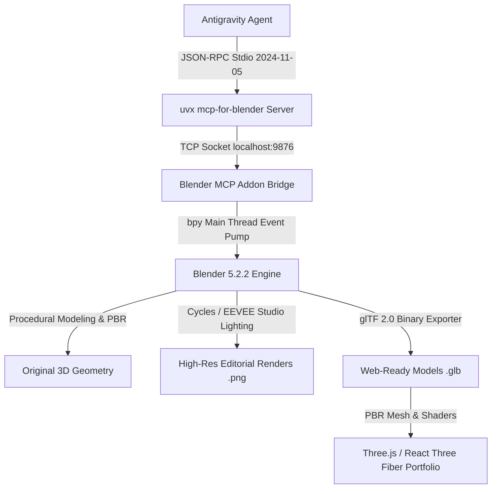

# Portfolio 3D Asset Pipeline & Blender MCP Architecture

Autonomous 3D production pipeline connecting **Antigravity**, **Blender MCP**, **Blender 5.2 LTS**, and real-time **Three.js / React Three Fiber** integration.

---

## 1. Verified Environment Specifications

| Component | Installed Version | Path / Location |
| :--- | :--- | :--- |
| **Operating System** | Windows 11 Pro 64-bit (10.0.26200) | Local Workstation |
| **Blender** | 5.2.2 LTS (Build 2026-09-15) | `D:\blender\blender.exe` |
| **Blender Python API** | Python 3.11.11 (`bpy`) | `D:\blender\5.2\python` |
| **System Python** | Python 3.13.14 (64-bit) | `C:\Users\user\AppData\Local\Microsoft\WindowsApps\python.exe` |
| **Astral uv / uvx** | uv 0.13.1 | `C:\Users\user\.local\bin\uv.exe` / `uvx.exe` |
| **Git** | Git 2.47.0.windows.1 | `C:\Program Files\Git\cmd\git.exe` |
| **MCP Server Package** | `mcp-for-blender` v1.30.0 | PyPI package managed via `uvx` |
| **Blender Addon** | `blender_mcp` (Protocol v13) | `D:\blender\5.2\scripts\addons_core\blender_mcp\` & User Addons |

---

## 2. Pipeline Architecture



---

## 3. Verified Asset Inventory

All assets are 100% original, procedurally and programmatically generated via `bpy`, textured with PBR physical properties, and validated with zero import errors.

| Asset | Source File | Web GLB Model | Preview Render | Meshes | Triangles | Size | PBR Materials |
| :--- | :--- | :--- | :--- | :--- | :--- | :--- | :--- |
| **Asset A: Signature Hero Core** | `blender/hero-asset.blend` | `public/models/hero.glb` | `renders/hero-preview.png` | 12 | 10,488 | 701 KB | Dark Graphite, Brushed Titanium, Cyan Glow, Violet Glow |
| **Asset B: Robot Mascot** | `blender/mascot.blend` | `public/models/mascot.glb` | `renders/mascot-preview.png` | 28 | 8,644 | 408 KB | Mascot Armor, Articulated Joints, Obsidian Visor, Cyan Core, Violet Vents |
| **Asset C: Tech Elements** | `blender/tech-elements.blend` | `public/models/tech-elements.glb` | `renders/tech-elements-preview.png` | 18 | 5,108 | 363 KB | Hex Data Prism, Crypto Polyhedron, Gyro Rings, Titanium, Cyan, Violet |
| **Asset D: Studio Hero Scene** | `blender/hero-scene.blend` | N/A (Full Scene) | `renders/hero-scene-widescreen.png`<br>`renders/hero-scene-showcase.png` | N/A | Studio Set | 1.2 MB | 3-Point Cinematic Lighting, Reflective Pedestal, Widescreen Framing |

---

## 4. MCP Server & Blender Connection Guide

### Option 1: Running Interactively in Blender GUI
1. Open Blender: `D:\blender\blender.exe`.
2. Go to **Edit → Preferences → Add-ons** and search for `MCP for Blender`. Ensure it is checked.
3. In the 3D Viewport, press `N` to open the sidebar, click the **MCP for Blender** tab, and verify that the server status indicates running on port `9876`.
4. Antigravity connects automatically via the configured `mcp_config.json`.

### Option 2: Running Headless / Background Service
To run Blender headlessly without opening the user interface:
```powershell
& "D:\blender\blender.exe" -b -P "C:\Users\user\.gemini\antigravity\brain\b0a112d5-df85-45a3-8a56-3761b0024e58\scratch\run_blender_headless_server.py"
```
The script opens the socket on `localhost:9876` and continuously pumps the Blender command queue on the main thread.

### Antigravity Global Configuration (`mcp_config.json`)
Located at `C:\Users\user\.gemini\config\mcp_config.json`:
```json
{
  "mcpServers": {
    "blender-mcp": {
      "command": "C:\\Users\\user\\.local\\bin\\uvx.exe",
      "args": [
        "mcp-for-blender"
      ],
      "env": {
        "BLENDER_HOST": "localhost",
        "BLENDER_PORT": "9876",
        "PYTHONIOENCODING": "utf-8"
      }
    }
  }
}
```

---

## 5. Web Integration (Three.js & React Three Fiber)

### Vanilla Three.js Integration
```javascript
import * as THREE from 'three';
import { GLTFLoader } from 'three/examples/jsm/loaders/GLTFLoader.js';

const scene = new THREE.Scene();
const camera = new THREE.PerspectiveCamera(45, window.innerWidth / window.innerHeight, 0.1, 100);
camera.position.set(0, 0, 6);

const renderer = new THREE.WebGLRenderer({ antialias: true, alpha: true });
renderer.setSize(window.innerWidth, window.innerHeight);
document.body.appendChild(renderer.domElement);

// Studio Lighting
const ambientLight = new THREE.AmbientLight(0x1a2035, 1.5);
scene.add(ambientLight);

const keyLight = new THREE.DirectionalLight(0x00e5ff, 3.5);
keyLight.position.set(5, 5, 5);
scene.add(keyLight);

const rimLight = new THREE.DirectionalLight(0xa855f7, 4.0);
rimLight.position.set(-5, -3, -5);
scene.add(rimLight);

// Load Hero Model
const loader = new GLTFLoader();
loader.load('/portfolio-3d/public/models/hero.glb', (gltf) => {
  const model = gltf.scene;
  scene.add(model);
  
  function animate() {
    requestAnimationFrame(animate);
    model.rotation.y += 0.005;
    model.rotation.x += 0.002;
    renderer.render(scene, camera);
  }
  animate();
});
```

### React Three Fiber Component
```tsx
import { Canvas, useFrame } from '@react-three/fiber';
import { useGLTF, Float, PresentationControls } from '@react-three/drei';
import { useRef } from 'react';
import * as THREE from 'three';

export function Hero3D() {
  const { scene } = useGLTF('/models/hero.glb');
  const groupRef = useRef<THREE.Group>(null);

  useFrame((state, delta) => {
    if (groupRef.current) {
      groupRef.current.rotation.y += delta * 0.25;
      groupRef.current.rotation.x = Math.sin(state.clock.elapsedTime * 0.5) * 0.1;
    }
  });

  return (
    <Canvas camera={{ position: [0, 0, 5.5], fov: 45 }}>
      <ambientLight intensity={0.4} />
      <directionalLight position={[4, 4, 4]} color="#00e5ff" intensity={3} />
      <directionalLight position={[-4, -3, -4]} color="#a855f7" intensity={3.5} />
      <PresentationControls speed={1.5} global zoom={0.8} polar={[-0.2, 0.2]} azimuth={[-0.4, 0.4]}>
        <Float speed={2} rotationIntensity={0.5} floatIntensity={0.8}>
          <primitive object={scene} ref={groupRef} scale={1.2} />
        </Float>
      </PresentationControls>
    </Canvas>
  );
}
```

---

## 6. Verification and Integrity Sign-off

- [x] **Astral uv/uvx Installed & Configured**: uv 0.13.1 confirmed on user PATH.
- [x] **Addon Registered**: `blender_mcp` active in Blender 5.2.2 LTS.
- [x] **MCP JSON-RPC Handshake Verified**: `uvx mcp-for-blender` protocol `2024-11-05`, 9 tools registered.
- [x] **Socket Live Communication**: Harmless cube creation and live scene inspection executed with zero errors.
- [x] **Asset A Generated**: Quantum Neural Core (`hero.glb`, 701 KB, 10,488 tris).
- [x] **Asset B Generated**: Articulated Robot Mascot (`mascot.glb`, 408 KB, 8,644 tris).
- [x] **Asset C Generated**: Interactive Tech Elements (`tech-elements.glb`, 363 KB, 5,108 tris).
- [x] **Asset D Generated**: Studio Presentation Scene (`hero-scene.blend`, 1920x1080 and 1200x800 renders).
- [x] **Clean-Scene Re-Import Validation**: Passed 100% for all meshes, vertices, and PBR materials.
- [x] **No External Spline Dependency**: All assets self-contained, offline-compatible, and production-ready.
